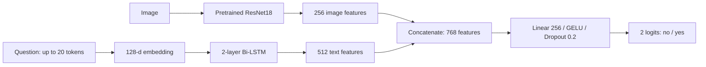
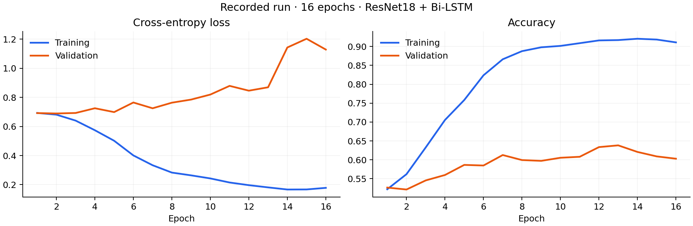

# Visual Question Answering · CNN + LSTM

Predict **yes** or **no** from an image and a natural-language question using
a pretrained ResNet18 and a bidirectional LSTM.

[](https://colab.research.google.com/github/ducnguyen1110/vqa-cnn-lstm/blob/main/notebooks/vqa_cnn_lstm.ipynb)
[](https://github.com/ducnguyen1110/vqa-cnn-lstm/actions/workflows/notebook.yml)

A course project completed as part of **AI VIET NAM · AIO2026 · Module 5**.
The goal is to study a small multimodal baseline: how visual and language
features combine and where the model overfits on a limited training set.

## Model



The image encoder is fine-tuned together with the text branch. Questions are
tokenized in English; the vocabulary is built from the training split only.
This is a classification baseline for yes/no questions, rather than an
open-ended answer generator.

## Recorded results

The supplied notebook contains **16 saved epochs** from a configuration set
to train for 50. The best recorded validation accuracy is **63.83% at epoch 13**,
with 91.68% training accuracy at that epoch. Executed test results are not
present in the supplied file.



The gap between training and validation accuracy is the main limitation of
this run. The cleaned notebook saves the best validation checkpoint before
test evaluation. It has not been retrained, so the figures above describe
the original recorded run.

See [experiment notes](reports/experiment.md) for the setup, limitations,
[epoch-level logs](reports/recorded_training.csv), and provenance.

## Run in Colab

Open the badge above, choose a GPU runtime, and run the notebook from top
to bottom. It installs dependencies and downloads the course dataset.
A T4-class GPU is recommended; reduce `train_batch_size` if memory is limited.
Colab storage is temporary: download `checkpoints/` before ending the session.

The Colab and CI links target `ducnguyen1110/vqa-cnn-lstm` on branch `main`.
They become available after this repository is published under that name.

## Run locally

Use Python 3.11 or 3.12. From the repository root on Windows:

```powershell
python -m venv .venv
.\.venv\Scripts\python.exe -m pip install --upgrade pip
.\.venv\Scripts\python.exe -m pip install -r requirements.txt
.\.venv\Scripts\python.exe -m jupyterlab
```

Open `notebooks/vqa_cnn_lstm.ipynb`, select the environment's kernel and run
cells in order. Data paths are relative to the kernel's working directory.
For GPU training, install a compatible CUDA build of PyTorch and torchvision
for your system using the [official PyTorch installer](https://pytorch.org/get-started/locally/).
CPU execution is supported but full training is considerably slower.

Dependency ranges are declared in `requirements.txt`; they are not a locked,
fully reproduced environment. The notebook prints installed versions so a
completed run can be recorded with its actual environment.

## Dataset

The course-provided COCO-derived subset contains **7,846 train**, **1,952
validation**, and **2,022 test** image-question pairs, as reported in the
supplied run. Dataset files and images are not included in this repository.

Expected layout after extraction, relative to the notebook's working directory:

```text
data/
├── vaq2.0.TrainImages.txt
├── vaq2.0.DevImages.txt
├── vaq2.0.TestImages.txt
└── val2014-resised/
```

The download ID is provided in the notebook. If it reaches a Google Drive
quota, obtain the archive from the course dataset folder and place it at
`data/vqa_coco_dataset.zip`. Keep the original directory spelling.

## Repository

```text
notebooks/vqa_cnn_lstm.ipynb    Complete training, evaluation and inference workflow
assets/learning-curves.png     Plot from the original saved training log
reports/                      Recorded metrics, provenance and experiment notes
scripts/check_notebook.py      Notebook schema and Python syntax validation
.github/workflows/             Automated notebook validation
requirements.txt              Local environment dependencies
```

Training creates `checkpoints/best.pt`, `checkpoints/history.json`, and
`checkpoints/metrics.json`. The checkpoint includes model weights, vocabulary,
labels, and model configuration. Large data files and model weights are
excluded from Git.

## Limitations and next steps

The current text representation uses the final padded LSTM position. A
length-aware representation would be a useful next experiment. Image
augmentation also needs care when a question refers to position or direction.
Before expanding the model, compare question-only and image-only baselines
and check whether images overlap across splits.

## Project checks

```powershell
python scripts/check_notebook.py
```

GitHub Actions validates the notebook format and compiles Python cells.
It does not download the dataset or run GPU training.

## Credits

Course context: **AI VIET NAM, AIO2026**. The original notebook is the basis
of this project. The data is a course-provided subset derived from COCO;
pretrained image weights are loaded through timm. Check the relevant provider
terms before redistributing data or third-party material. This repository
does not grant a separate license for those materials.
