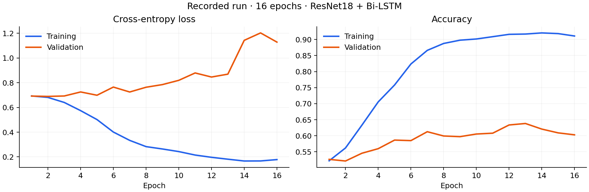

# Recorded experiment

These figures come from saved outputs in `Project_VQA_CNN+LSTM.ipynb`.
The original file is unchanged. Its SHA-256 is stored in
[source_provenance.json](source_provenance.json).

## Data and setup

The saved run reports 7,846 training pairs, 1,952 validation pairs, and 2,022
test pairs. Labels are `no` (0) and `yes` (1). The training vocabulary has
1,678 entries. Questions are padded or truncated to 20 tokens.

ResNet18 is initialized with pretrained weights through timm and fine-tuned.
Its output dimension is 256. The text branch uses 128-dimensional learned
embeddings and a two-layer bidirectional LSTM with hidden size 256 per
direction. Concatenated features have size 768 and feed a 256-unit GELU
classifier with dropout 0.2 and two output logits.

The configuration requests 50 epochs, Adam at 0.001, StepLR with step size
40 and gamma 0.1, seed 59, training batch size 256 and evaluation batch size
32. Only 16 epoch logs are saved; the file does not establish why the run ended.

## What the saved outputs support

- Best recorded validation accuracy: **63.83%**, epoch 13.
- Training accuracy at epoch 13: **91.68%**.
- Final recorded validation accuracy: **60.30%**, epoch 16.
- Test accuracy: **not available in executed outputs**.

The original narrative mentions 65.4% test accuracy, an MLP comparison and
per-question-type results. There are no executed outputs in this file to
substantiate those claims, so they are not presented as measured results here.
The epoch-level values are available in [recorded_training.csv](recorded_training.csv).

## Interpretation

Training accuracy increases while validation accuracy remains much lower.
Validation loss generally rises after the first few epochs. This run shows
substantial overfitting on the small training subset.

A majority-class predictor on the recorded validation labels would obtain
1,046 / 1,952 = 53.59%. This is a label-count reference, not a trained baseline.
The 63.83% best validation score is approximately 10.24 percentage points higher.

## Changes in the cleaned notebook

The model still uses the final padded LSTM position and concatenation fusion.
Changes cover setup and execution: a plain-Python vocabulary replaces torchtext,
spaCy's blank English tokenizer removes the model download, image reads use RGB,
dataset paths are configurable, losses are sample-weighted, inference uses eval
mode, and the best validation checkpoint is saved and restored before testing.

These edits have not been validated by a full GPU training run. The blank
tokenizer can differ from the original packaged tokenizer. The recorded results
describe the supplied notebook, not the revised notebook. Re-run training to
measure the revised pipeline, and retain the printed dependency versions.

## Follow-up experiments

Try length-aware question encoding, image-only and question-only baselines,
image-level split-overlap checks, and augmentations that preserve spatial
meaning. Compare changes on validation data before evaluating once on test.
